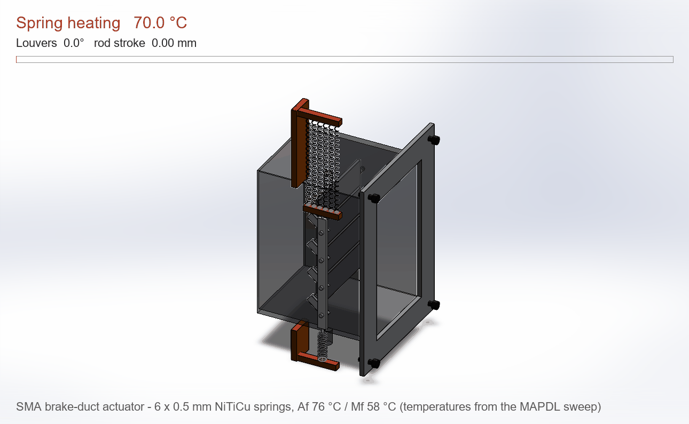
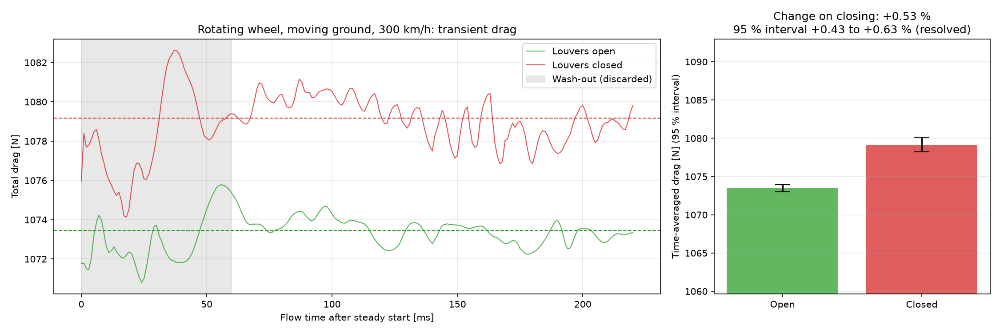
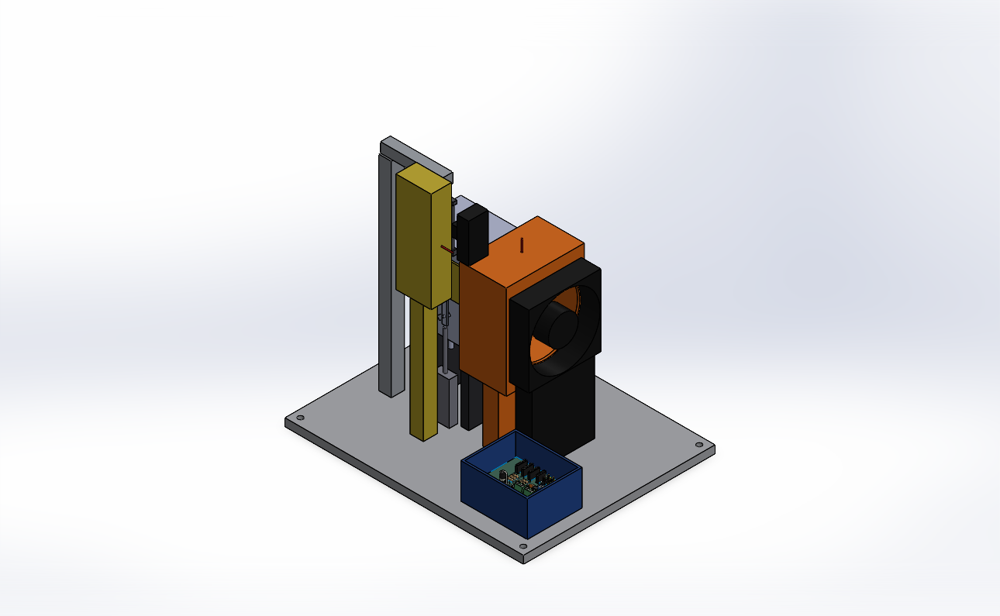
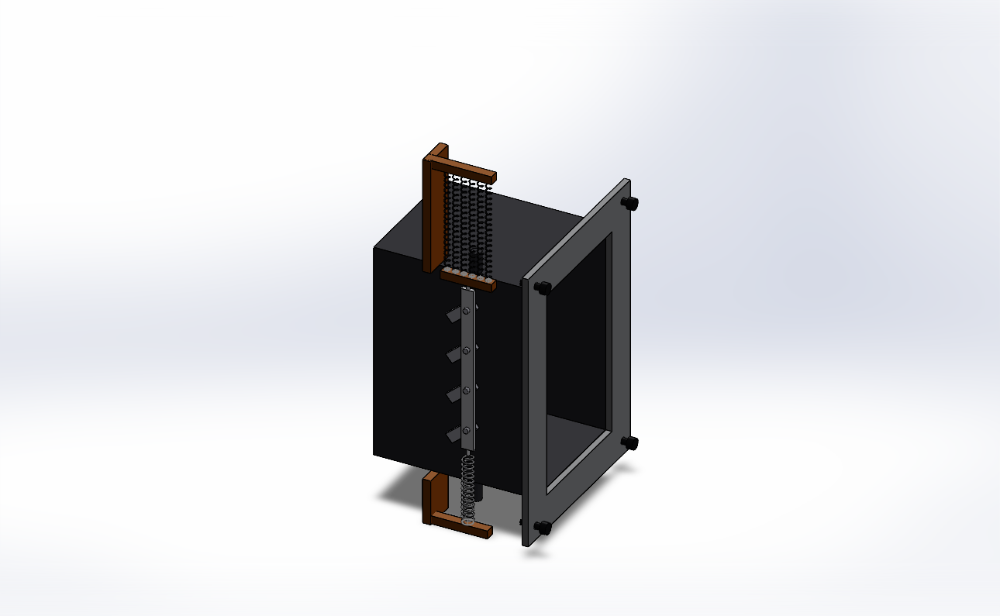
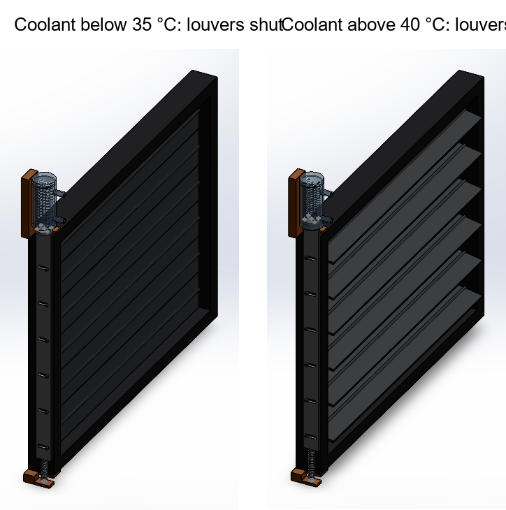

# Passive SMA Brake Duct: feasibility study

Can a brake-cooling duct open and close itself, with no electronics, using a
shape-memory-alloy (Nitinol) spring heated by the brake disc?

The idea: louvers in the duct stay shut on the straights to cut drag, and a
spring heated by the rotor opens them after heavy braking.
I modelled the mechanism in SOLIDWORKS, ran thermal and aero CFD in ANSYS
Fluent, checked the structure in ANSYS MAPDL, and tested the actuator
behaviour over a simulated lap.

**Start here:** [Project Guidebook (PDF)](report/Project_Guidebook.pdf), which covers the problem, how it works, every
phase, tools, results and limits. A web version is in [docs/GUIDEBOOK.md](docs/GUIDEBOOK.md).

Product package: [one-page product sheet](report/SMA_Duct_Module_Product_Sheet.pdf),
[assembly drawing SMA-DM-001](cad/product/SMA-DM-001.pdf),
[design notes](docs/PRODUCT.md).

## What I found

| Question | Answer | Evidence |
|---|---|---|
| Does the linkage give enough stroke? | Yes: 14.0 mm rod travel for 80° of louver rotation | SOLIDWORKS mates, `cad/` |
| Is air near the rotor hot enough to trigger the spring? | No: 300-324 K against the 358 K needed | Fluent, `cfd/Temp_Contour_CaseA*.png` |
| Can rotor radiation trigger it? | Yes, if the wire is dark (emissivity ≥ ~0.45) | 119-129 kW/m² incident, `cfd/SMA_Wire_Temperature_CaseA.png` |
| Does it close again on the straight? | Yes: wire settles at 306-311 K | Fluent Case B |
| Does the specified 1.2 mm NiTi spring work over a lap? | No. It is too slow to heat and its hysteresis is too wide | `cfd/transient/` |
| Redesign | Six 0.5 mm NiTiCu springs (Af 76 °C, Mf 58 °C). They open after the 3 hardest braking zones and are open 2 % of straight-line time | `cfd/transient/`, `fea/pack_NiTiCu/` |
| Stresses OK? | Yes, lowest factor of safety 3.3 | MAPDL, `fea/` |
| Does closing the louvers cut drag by 18.4 %, as the brief assumed? | **No. With a rotating wheel on a moving road, closing them adds 0.5 % drag** | Isolated-wheel Fluent, `cfd/wheel/` |
| Where does the idea pay off? | On an EV grille shutter: closing it cuts drag 14.5 % on a simple CFD car, and about 3-5 % of battery energy on a real one | `ev/`, `docs/EV_COOLING.md` |

The drag result is the main finding, reached in three steps:

1. **Scale.** The duct's own through-flow drag is the momentum of the air it
   swallows: 0.155-0.183 kg/s × 83 m/s ≈ 13-15 N, or 1.1-1.4 % of total drag
   on every mesh. Closing the inlet also changes the outside flow
   (interference), so this is not a hard cap, but 18 % would need
   interference more than ten times larger.
2. **Mesh study, stationary wheel.** On 284k, 408k and 768k cells the
   open-vs-closed difference (-9.6 %, +5.2 %, -1.3 %) stayed within the
   solver noise from the unsteady wheel wake.
3. **Rotating wheel on a moving road, time-averaged over 160 ms of transient
   flow.** Closing the louvers *adds* 0.53 % drag (95 % interval +0.43 to
   +0.63 %). The duct's own drag falls by 0.4 N, but the wheel's rises by
   more.

The full numbers, method and limits are in [docs/RESULTS.md](docs/RESULTS.md),
and the write-up is in [report/ThermoKinetic_BrakeDuct_Whitepaper.pdf](report/ThermoKinetic_BrakeDuct_Whitepaper.pdf).

## Bench rig (designed and virtually tested, not built yet)

The next step is a bench rig that heats the spring pack the way the braking
rotor does and cools it the way the airflow does, so the simulations can be
checked against measurements. It has a halogen lamp standing in for the rotor
and a blower standing in for car speed, with thermocouples, a magnetic angle
sensor and a load cell. It consists of:

- **Rig CAD:** SOLIDWORKS assembly with zero interferences.
- **Electronics:** an Arduino Uno shield in KiCad. ERC and DRC are clean, and
  Gerbers are ready to order.
- **Firmware:** compiled for the Uno, using 57 % of flash and 55 % of RAM.
- **Digital twin:** runs the same firmware code against a physics model of the
  rig. The Phase 4 logger connects to it over a TCP "serial port".

| Virtual test | Twin result |
|---|---|
| Slow ramp hysteresis | Opens 72-75 °C, closes 63-60 °C, 11.5 °C wide (design 12 °C) |
| 0.5 mm vs 1.2 mm wire | Closes in 1.9 s vs 5.7 s |
| Car lap replayed on the rig | Same 3 openings per lap as the car model, 87 % open/closed agreement |
| 1,000 heat/cool cycles | All complete, no firmware faults (no fatigue model) |
| Sensor and cooling failures | Heater latches off in both cases |

The twin also caught design problems before anything was built:

- **Heater switching window:** at 1 s it distorted the hysteresis measurement,
  so it is now 200 ms.
- **Rig capacity:** the first layout was too weak to reproduce the car lap, so
  a blower was added and the lamp moved closer.
- **Phase 1 CAD bug:** the linkage rod was sitting on the wrong side of the duct.

Details are in [docs/RIG.md](docs/RIG.md).

## Product package

The actuator is also detailed as a product:
- **Module CAD:** production-level detail, including real helical NiTiCu
  springs with a black coating, a steel bias spring, anodised brackets and an
  inlet flange with M3 fasteners. 21 components, zero interferences.
- **Animation:** the springs genuinely stretch and contract as the louvers
  open and close.
- **Drawing:** A3 assembly drawing SMA-DM-001 with a parts list.
- **Product sheet:** one-page summary.
- **Rig CAD:** the bench rig now carries the real 3D circuit board exported
  from KiCad.

See [docs/PRODUCT.md](docs/PRODUCT.md).

## Re-target: passive grille shutter for an EV

F1 bans moving aero parts and the brake duct moves too little air to
matter, so I moved the same idea to where it can pay: an EV radiator
shutter. A low-temperature NiTi spring pack (As 35 / Af 40 °C) sits in the
coolant return line and opens six louvers when the coolant warms. It needs
no motor, sensor or wiring.

- **CFD, half car with a porous radiator and moving road:**
  - Closing the shutters cuts drag by 105 N at 100 km/h and 182 N at
    130 km/h, both 14.5 %. Iteration noise is under ±10 N, and the saving
    scales with V².
  - About three quarters of the saving is interference from the plain
    floor exit, not the radiator's own momentum drag.
- **Drive-cycle model, with cooling drag in the road load:**
  - At a production-car level of cooling drag the shutter saves 3.4 % of
    battery energy in the city and 5.4 % at 130 km/h. A motorised
    thermostat shutter saves 4.5 %.
  - On a 38 °C day it opens fully and the coolant peak matches an open
    grille.
- **Module CAD:** frame, six louvers, a scotch-yoke bar (14.8 mm lift for
  80°), the SMA pack in a clear coolant sleeve and a bias spring. Zero
  interferences shut and open.

See [docs/EV_COOLING.md](docs/EV_COOLING.md).

## Limits (read before quoting numbers)

- ANSYS Student licence: meshes are capped at 1M cells, so the CFD is coarse.
- Drag study: the rotating-wheel result is averaged over only 160 ms (about
  four wake cycles) on one mesh, and its 95 % interval covers sampling noise
  only. The drag coefficient (1.19) is still above real-wheel values.
- The lap model is reduced-order, on a synthetic lap trace, calibrated to two
  steady Fluent cases.
- The NiTiCu transformation temperatures are design targets, not a datasheet
  alloy.
- **No hardware was built or tested.** The bench file in `bench/` is a
  simulated dry run of the data logger, and the rig results in
  `bench/virtual/` come from the digital twin, not measurements.
- Moving aero parts are banned under the F1 technical regulations, so this
  is a research and non-FIA concept.

## Tools

SOLIDWORKS 2025, ANSYS Student 2026 R1 (Fluent, MAPDL), KiCad 10,
Arduino (Uno), C++, gmsh and Python.

## Repo layout

| Path | Contents |
|---|---|
| `phase1_*.py`, `swlib.py` | SOLIDWORKS parts and assembly |
| `phase2_*.py` | Fluent CHT domain, meshing, solves, radiation, lap model, wheel aero |
| `phase3_fea.py` | MAPDL linkage and stress model |
| `phase4_bench_validation.py` | DAQ logger (only run in simulation) |
| `phase5_generate_whitepaper.py` | Builds the PDF from the result files |
| `rig_cad.py`, `rig_import_pcb.py` | SOLIDWORKS bench rig parts and assembly, shield PCB import |
| `product_*.py` | Product module CAD, animation, drawing and product sheet |
| `electronics/` | KiCad shield: schematic and PCB generators, Gerbers, BOM |
| `firmware/` | Arduino firmware, lap-profile generator, digital twin and test campaign |
| `ev/` | EV grille-shutter re-target: sizing, half-car CFD, drive-cycle model, shutter CAD |
| `cad/`, `cfd/`, `fea/`, `bench/`, `report/` | Models, plots and result JSON |

Solver case and data files (several GB) are not included. Re-running needs
SOLIDWORKS and ANSYS installed. Run order is in
[docs/RESULTS.md](docs/RESULTS.md#re-running).
