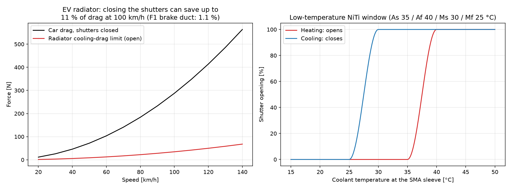
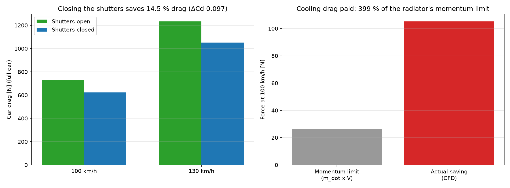
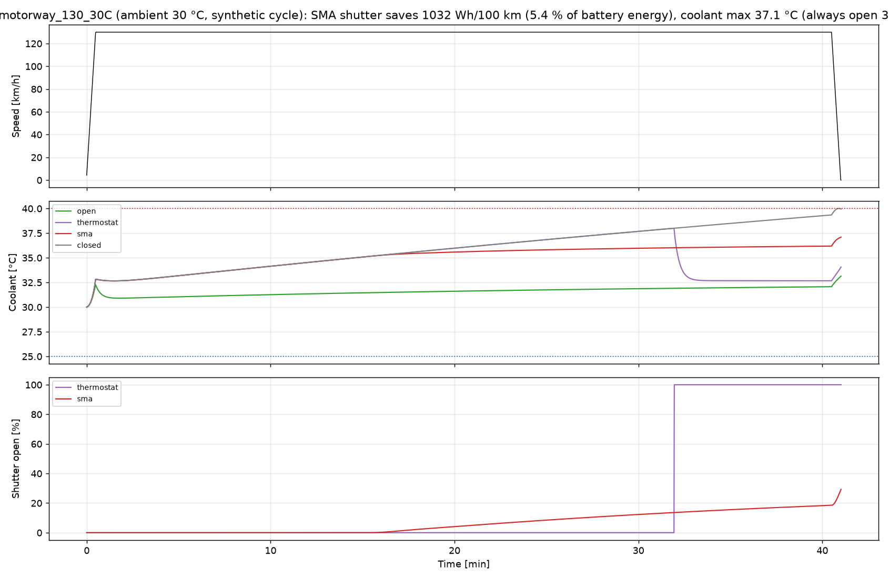
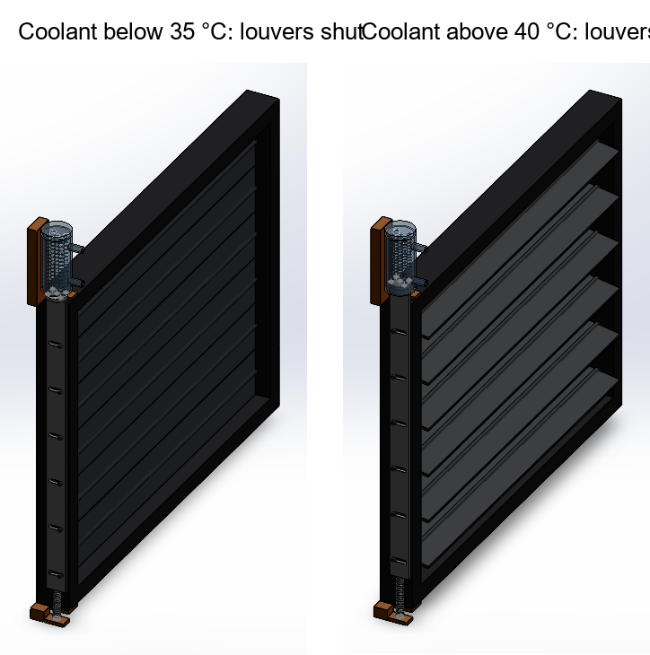

# Re-target: passive SMA grille shutter for an electric car

F1 rules ban moving aero parts, and the brake-duct study showed the duct
moves too little air for its louvers to matter for drag. A road EV is the
opposite case. Its front radiator swallows about ten times more air than
the brake duct does, relative to the car's drag, and the battery loop
runs cool enough (25-40 °C) for a low-temperature NiTi alloy. So the same
idea, a spring that opens louvers when it gets warm with no motor, sensor
or wiring, was re-targeted to an EV grille shutter.

The work follows the same order as the F1 project: size it, simulate it,
measure the drag with CFD, then model the device.

## 1. Concept and sizing (`ev/ev_concept.py`)

* **Car:** compact EV, 1800 kg, Cd 0.27 with shutters shut, 2.30 m² frontal
  area.
* **Radiator:** 450 x 350 mm low-temperature core, 25 mm deep, loss
  coefficient K = 10.
* **Shutter:** six louvers, 58 mm chord, 80° full opening.
* **Actuator:** five NiTi springs, 1.0 mm wire on a 5 mm coil. Each one
  gives about 19.6 N, which covers the 98 N that the sizing asks for at
  140 km/h.
* **Alloy:** As 35 / Af 40 / Ms 30 / Mf 25 °C. The springs sit in a
  sleeve on the coolant return line, so they follow the coolant
  temperature, not the air.

At 100 km/h the radiator takes about 1 kg/s of air. Its momentum drag
(ṁ V) is roughly 10 % of the car's drag, against 1.1 % for the F1 duct.

## 2. CFD: how much drag does closing the shutters save? (`ev/ev_cad.py`, `ev_mesh.py`, `ev_solve.py`)

**Model:**
* Half car, 4.4 m long, cut on its centre plane.
* A grille opening leads to the radiator, then a duct turns down and
  exits through the floor.
* The radiator is a porous zone with the core's pressure loss.
* The road moves at car speed.
* The closed case seals the first 40 mm of the duct, as if the shutter
  blades were shut.
* Steady k-ω SST.
* 375k cells open, 400k cells closed.
* Each case runs 900 iterations at 100 km/h and 130 km/h.

**Drag accounting:** car drag is the force on every car wall plus the
pressure drop across the radiator core times its area. Both are doubled
for the full car.

| | 100 km/h | 130 km/h |
|---|---|---|
| Drag, shutters open | 727 N | 1233 N |
| Drag, shutters closed | 622 N | 1051 N |
| Saving | **105 N (14.5 %)** | **182 N (14.7 %)** |
| ΔCd | 0.097 | 0.099 |
| Radiator mass flow, open | 0.95 kg/s | 1.22 kg/s |
| Momentum term ṁ V | 26 N | 44 N |
| Saving / ṁ V (κ) | 4.0 | 4.1 |
| Iteration noise (half band) | ±3-6 N | ±4-10 N |

**Checks:**
* The saving grows 1.73 times from 100 to 130 km/h. V² grows 1.69 times,
  so the result scales like a real drag force.
* The noise is under 10 % of the saving, so, unlike the F1 wheel case,
  the difference is clearly resolved.

**What κ ≈ 4 means.** Closing the shutters saves four times the air
momentum the radiator takes in. The rest is interference:
* The open duct dumps a jet through the floor.
* That jet disturbs the underbody and wake flow.

This CFD body is simple: a box nose, a plain floor exit, and Cd 0.67
against 0.27 for a real car. Its interference is therefore much larger
than on a production car, where engineers shape the cooling exit to
recover pressure. Published production-car cooling drag is usually about
equal to ṁ V or a little less.

**So the system model is run at two settings:**
* κ = 1, a production-car estimate;
* κ = 4.06, this CFD.

The truth for a real car lies between them, nearer the low end.

## 3. Drive-cycle model (`ev/ev_system.py`)

**What it covers:** a lumped battery and coolant loop over four scenarios,
with heat from:
* motor and inverter losses (7 % of drive power);
* the battery's I²R loss;
* a 100 W auxiliary load.

**How the radiator is modelled:**
* Air mass flow uses the CFD flow coefficient (ṁ / ρAV = 0.176 with the
  shutters fully open).
* 8 % of the flow leaks past the shutters when they are shut.
* Cooling drag is part of the road load, so it shows up in battery energy.

**Shutter strategies compared:**
* Always open (no shutter).
* Always closed.
* A motorised thermostat shutter: opens at 38 °C, closes at 32 °C.
* The passive SMA shutter. Its springs follow the coolant through a 40 s
  sleeve lag and use the alloy's hysteresis with return-point memory.

| Scenario | SMA shutter | Coolant max (SMA / always open) | Battery energy saved, κ = 1 | κ = 4.06 |
|---|---|---|---|---|
| City, WLTC-like x2, 25 °C | stays shut | 33.3 / 28.7 °C | 3.4 % (524 Wh/100 km) | 12.5 % |
| Motorway 130 km/h, 30 °C | stays shut | 37.1 / 33.1 °C | 5.4 % (1032 Wh/100 km) | 18.1 % |
| Hot day 130 km/h, 38 °C | opens fully | 41.1 / 41.1 °C | 0 % (correctly gives way to cooling) | 0 % |
| Cold day, WLTC-like x2, 5 °C | stays shut | 13.3 / 8.7 °C | 3.4 % | 12.5 % |

Baseline consumption with the shutters always open is 16.5 kWh/100 km in
the city and 21.4 kWh/100 km on the motorway, which is in the normal
range for a compact EV.

**What it shows:**

* **It does no harm when cooling is needed.** On the 38 °C day the SMA
  shutter opens fully. The coolant peak is the same 41.1 °C as the
  always-open grille, and the time above 40 °C is only 5 s longer
  (286 s against 281 s). Always-closed reaches 48 °C.
* **It beats the motorised thermostat on the motorway.** It saves 5.4 %
  against 4.5 %, and holds the coolant 0.9 °C lower (37.1 against
  38.0 °C). Its 35-40 °C band plus the sleeve lag avoid the on-off
  cycling of a 32/38 °C thermostat.
* **It saves energy without power.** It uses no motor, no wiring and no
  control unit, and keeps working if the 12 V system fails.
* **The realistic gain is 3-5 % of battery energy** at κ = 1. The 12-18 %
  at κ = 4 belongs to the crude CFD body, not to a real car.

Drive cycles are synthetic. "WLTC-like" uses the WLTC class-3 phase
lengths and top speeds, not the official speed trace.

## 4. Shutter module CAD (`ev/ev_shutter_cad.py`)

| Part | Detail |
|---|---|
| Frame | Glass-filled PA66, 490 x 390 x 40 mm, opening 450 x 350 mm to match the core |
| Louvers x6 | 58 mm chord, 448 mm span, 3 mm thick, Ø6 mm pivot pins at a 58.3 mm pitch; each has a 15 mm crank and a Ø4 mm crank pin |
| Yoke bar | Aluminium, with six slots (scotch yoke): the bar moves straight up 15 sin θ, 14.8 mm at 80° |
| SMA pack | Five NiTi springs inside a clear coolant sleeve with two hose spigots, hung from the sleeve cap and pulling the bar up |
| Bias spring | Steel tension spring under the bar, pulling the louvers shut |
| Brackets | Anodised actuator bracket and bias-spring anchor |

**How it moves:**
* **Warm coolant:** the springs shorten from 76 to 61 mm. The bar lifts and
  turns all six louvers open together.
* **Cooling down:** the bias spring stretches them back.

**Spring strain:** the shear strain at full stroke is about 1.2 %. This is
well inside the range NiTi can repeat for many cycles.

**Checks:** the model was assembled shut (0°) and fully open (80°), and
interference detection found zero clashes in both poses.

The first build attempt did find a clash, and it was a real one. Three
pivot bores and three yoke slots had not been cut, because cutting several
tools in one operation silently skips some of them. Each feature is now
cut on its own.

## 5. Limits

* **The CFD car is crude:** a box nose, a plain floor exit, Cd 0.67. The
  absolute drag and the size of the interference (κ ≈ 4) do not carry over
  to a production car, but the open-against-closed method does.
* **The thermal model is lumped,** and its heat loads are estimates.
* **The cycles are synthetic.**
* **The alloy temperatures are a design target:** As 35 / Af 40 °C needs a
  Ni-rich NiTi or a NiTiCu grade that must be sourced and characterised.
* **Unmodelled real-world issues:** the sleeve lag, the spring fatigue
  life, and the seal on the coolant sleeve all need bench testing.
