# Project Guidebook: Passive SMA Brake-Duct Actuator

**What it is:** a brake-cooling duct whose louvers open and close by
themselves, driven by shape-memory-alloy springs heated by the brake disc.
There are no sensors, wires, motors or power supply in the device.

**What this guidebook covers:** the problem, how the device works, how each
part of the project was designed and checked, which tools were used and why,
what was found (including what did not work), and how to reproduce
everything.

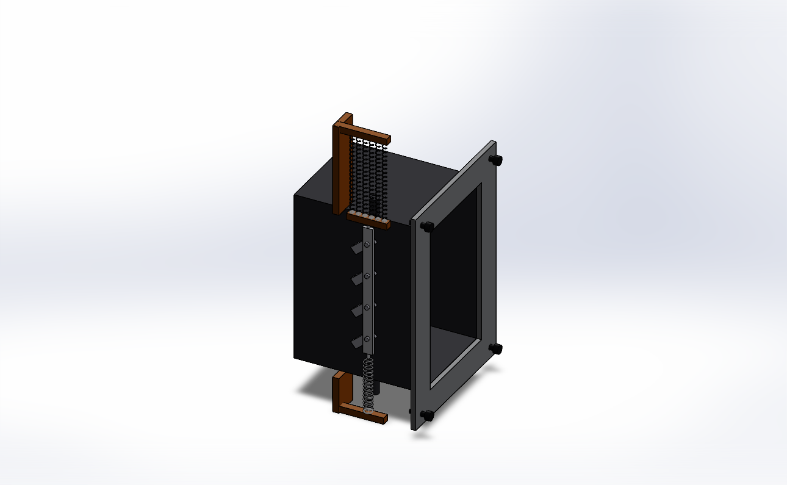

---

## 1. The problem

A Formula 1 brake disc reaches about 800-1000 °C under heavy braking. The
brakes are cooled by ducts that scoop air from in front of the wheel. Ducts
have a fixed size, so they are a compromise:

* **Under braking** the disc needs as much air as possible, or the friction
  material overheats and wears.
* **On the straights** the brakes are idle, so cooling air is wasted. The air
  pushed through the duct costs aerodynamic drag.

The idea: **close the duct on the straights and open it when the brakes are
hot**, with no electronics. The design brief set three targets:

| Target in the brief | Value |
|---|---|
| Drag saved on straights by closing the duct | -18.4 % |
| Temperature at which the louvers start to open | 85 °C |
| Rod stroke for full opening | 14.2 mm |

Part of this project's value is that it **checks the brief instead of
assuming it**. Two of the three targets held up; the drag target did not
(section 5.8).

## 2. How the device works

### 2.1 Shape-memory alloy in one paragraph

Nickel-titanium (Nitinol) has two crystal structures. Below a transformation
temperature it is soft **martensite** and can be stretched easily. Heated
past the **austenite finish temperature (Af)**, it returns to its remembered
shape and pulls with a large force. On cooling past the **martensite finish
temperature (Mf)** it becomes soft again. The gap between opening and
closing temperatures is the **hysteresis**. A one-way SMA spring cannot push
itself back, so a steel **bias spring** stretches it again when it cools.

### 2.2 The mechanism

* Four louvers sit across the duct throat, each on a pivot shaft.
* Each louver has a small external **crank arm** (radius 10.89 mm). A single
  **linkage rod** joins the four crank pins, so all louvers move together.
* A pack of **six NiTiCu springs** pulls the rod up when hot. The **bias
  spring** pulls it down when cold.
* Rod stroke and louver angle are linked by the crank geometry:

  `stroke = R (sin(θ + φ0) - sin φ0)`, with R = 10.89 mm and φ0 = -40°

  This gives 14.0 mm of stroke at 80° of louver rotation, and 15.15 mm at
  88.5°.

 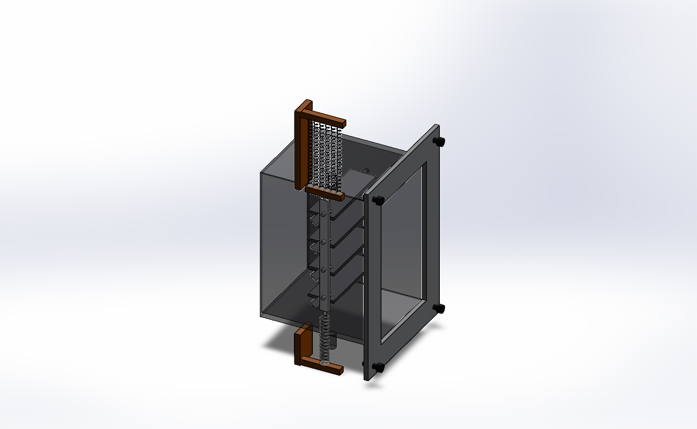

### 2.3 What heats the spring

The project found that **hot air alone cannot do it**; the air near the
duct stays far too cool (section 5.2). The spring is heated by **thermal
radiation from the glowing disc**. It is coated black (emissivity about
0.8) to absorb that radiation, and is cooled by the airflow when the car is
fast.

## 3. Results at a glance

| Question | Answer |
|---|---|
| Does the linkage give the stroke? | Yes: 14.000 mm at 80° (SOLIDWORKS kinematics) |
| Can hot air trigger the spring? | No: 300-324 K against 358 K needed (Fluent CHT) |
| Can rotor radiation trigger it? | Yes: 119-129 kW/m² on the spring; a dark wire reaches 378-414 K |
| Does it close again on the straight? | Yes: wire settles at 306-311 K, below Mf |
| Does the brief's 1.2 mm NiTi spring work over a lap? | No: it never opens, or stays stuck open |
| Fix | Six 0.5 mm NiTiCu springs (Af 76 °C / Mf 58 °C): open after the 3 hardest braking zones, open only 2 % of straight time |
| Is it strong enough? | Yes: all stress checks pass, lowest factor of safety 3.3 (MAPDL) |
| Does closing the duct save 18.4 % drag? | **No. The duct's own momentum drag is only 1.1-1.4 % of the total, and with a rotating wheel and moving road closing actually adds 0.5 % drag** |
| Is it legal in F1? | No: moving aerodynamic parts are banned |
| Can it be tested? | A bench rig, its electronics, firmware and a digital twin are designed; the twin predicts the rig reproduces the car behaviour |
| Where does the idea pay off? | An EV grille shutter: closing it cuts drag 14.5 % on a simple CFD car; on a real car about 3-5 % less battery energy, with no motor or wiring |

## 4. Tools used and why

| Tool | Used for |
|---|---|
| SOLIDWORKS 2025 | All CAD: parts, assemblies, mates, kinematic checks, interference checks, CFD domains, drawings, renders |
| ANSYS Fluent 2026 R1 (Student) | Conjugate heat transfer with radiation; isolated-wheel aerodynamics |
| ANSYS MAPDL 2026 R1 (Student) | Linkage mechanism and spring force model; stress checks with contact |
| gmsh | Tetrahedral meshing of parts for MAPDL |
| Python | Heat-balance and transient lap models, data logger, post-processing, plots, reports |
| KiCad 10 | Schematic, PCB layout, design-rule checks, Gerbers, 3D board model |
| Arduino | Firmware for the test rig's controller (Arduino Uno) |
| C++ | Firmware logic, also compiled for the PC to run the digital twin |

All models, settings and results are kept in the repository, so every
result can be reproduced.

## 5. The work, phase by phase

### 5.1 Phase 1 - CAD and kinematics (SOLIDWORKS)

**Built:** the packaging zone around a 328 mm disc and a 400 mm rim. A
100 x 60 mm duct throat (80 mm long, 2 mm carbon wall). Four 56 x 18 x 2 mm
louvers on 20 mm pitch with external cranks, and the linkage rod. 16 mates.

**Checked:** a temporary angle mate drove louver 1 through 0-80°, and the
rod position was read at each step. The measured stroke matched the crank
formula to 0.001 mm (14.000 mm at 80°).

**Bug found and fixed later:** concentric mates only align axes, so the rod
had solved on the wrong side of the duct, about 70 mm from the crank pins.
The assembly now checks the rod position and flips the distance mate if
needed.

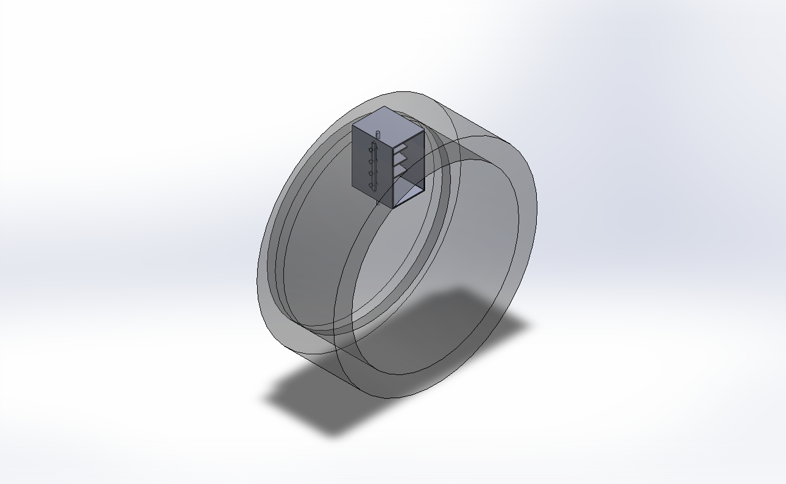

### 5.2 Phase 2 - Can the spring be triggered? (Fluent CHT)

**Model:** a box around a rotor segment, the duct, the louvers and a pocket
of air where the spring sits. Solids and air are solved together (conjugate
heat transfer), with k-ω SST turbulence and Discrete Ordinates radiation.
Meshes are about 0.5 million cells (the Student licence caps at 1 million).

* **Case A, braking:** 100 km/h, 800 °C rotor, louvers closed.
  * Spring pocket beside the duct: 300.3 K.
  * Pocket moved to the rotor's wake face: 324.1 K.
  * Both are well short of the original spring's 358 K (85 °C). The hot air
    is only a ~2 mm layer against the disc.
* **Radiation check:** the disc puts 119-129 kW/m² of radiation on the
  relocated pocket. A heat balance on the wire, with absorbed radiation
  against re-radiation and convection, gives 378-387 K for a wire
  emissivity of 0.6 and 403-414 K at 0.8.
  * **Conclusion:** the spring works if it is dark (emissivity of at least
    about 0.45).
* **Case B, straight:** 300 km/h, 400 °C rotor, louvers open. Radiation falls
  to about 20 kW/m² and airflow doubles. The wire settles at 306-311 K,
  below Mf, so **the louvers close again**.

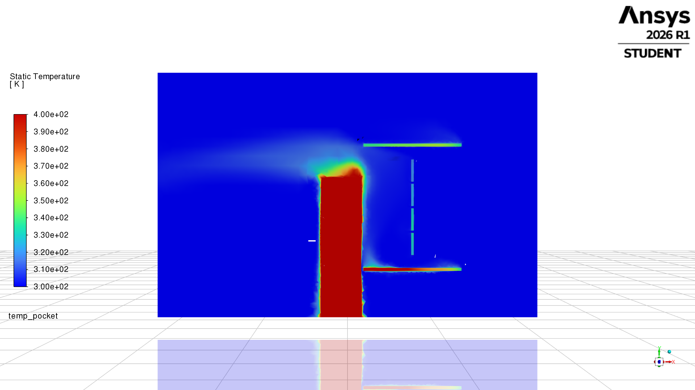

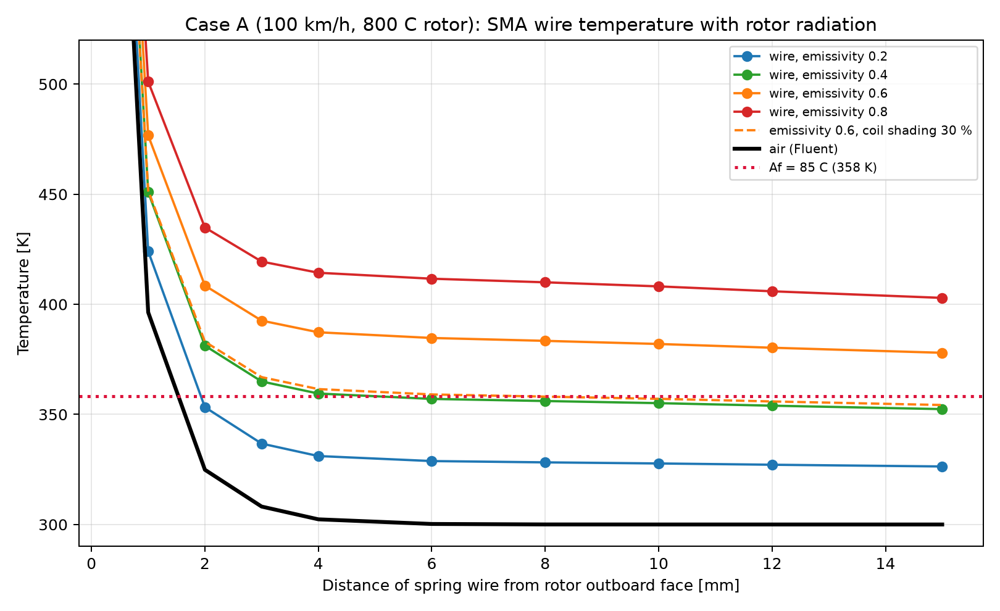

### 5.3 Phase 2 - Does it work over a whole lap? (transient model)

Steady cases are not enough: brake temperatures change every few seconds.
A reduced-order lap model:

* **Lap trace:** a synthetic 98.5 s lap with five braking zones, 300 to
  100 km/h.
* **Rotor:** heat balance fitted to the brief (800 °C peak, 400 °C on the
  longest straight).
* **Spring environment:** radiation and airflow at the spring interpolated
  between the two Fluent cases.
* **Wire physics:** wire heat balance with latent heat, Liang-Rogers
  transformation kinetics, and stroke from the MAPDL sweep.

| Spring | Result over a lap |
|---|---|
| Brief: NiTi 1.2 mm, Af 85 °C | Never opens (emissivity 0.6), or opens then stays open on 91 % of straights (0.8) |
| **Redesign: NiTiCu 0.5 mm, Af 76 / As 70 / Ms 64 / Mf 58 °C, emissivity 0.8** | **Opens 4-5 s after the 3 hardest braking zones; open only 2 % of straight time** |

**Why the redesign works:**
* **Faster response:** a 1.2 mm wire takes about 5 s to respond, while the
  rotor peak lasts only a moment. A 0.5 mm wire responds in about 1.4 s.
* **Narrower hysteresis:** NiTi's ~40 K hysteresis is wider than the wire's
  temperature swing over a lap, so it can never cycle. NiTiCu's ~12 K fits.

The cost is force: one thin spring gives about 5.6 N, so six are used in
parallel.

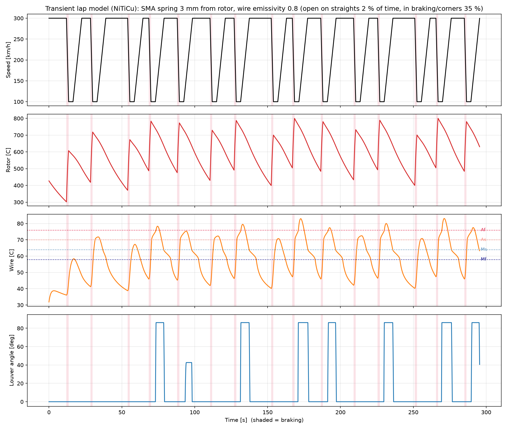

### 5.4 Phase 3 - Structure and force (MAPDL)

* **Mechanism model:** beam elements for the linkage, plus a nonlinear spring
  element carrying the SMA's temperature-dependent force against the bias
  spring and the aerodynamic torque on the louvers.
* **Stress model:** solid tetrahedral meshes of the louver, pins, rod and
  housing holes, with contact. Each joint is checked against a factor of
  safety of 2.5.

| | Brief spring | Six-spring NiTiCu pack |
|---|---|---|
| Hot state | 86.2° / 14.85 mm at 85 °C | 88.5° / 15.15 mm at 76 °C |
| Louver pins, hot | 17.2 MPa, FoS 8.1 | 18.0 MPa, FoS 7.8 |
| Lowest FoS anywhere | 3.3 | 3.3 |

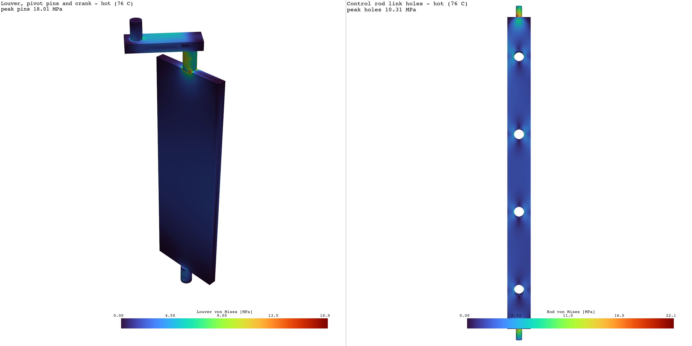

### 5.5 Phase 4 - Data logger

A Python logger reads one JSON line per sample at 20 Hz:
* **Recording:** it logs temperature, force and stroke, and draws a live
  dashboard.
* **Correlation:** it compares each sample with the FEA prediction and
  reports onset temperature, hysteresis width, stroke and force error.
* **Connection:** it works with a real serial port or, unchanged, with the
  digital twin over a TCP "serial port" (section 5.7).

### 5.6 Phase 5 - Technical whitepaper

The whitepaper is a 6-page PDF assembled directly from the result files.
* **Labelling:** every value is marked as measured, simulated or design
  target.
* **Content:** it includes the FIA regulation assessment.

### 5.7 Phase 6 - Bench rig, electronics, firmware and digital twin

**The rig** (SOLIDWORKS, zero interferences):
* **Rotor stand-in:** a 500 W halogen lamp in a reflector, 23 mm from the
  springs (about 143 kW/m²).
* **Car-speed stand-in:** a 50 mm blower aimed at the springs (about 13 m/s).
* **Duct flow:** a 92 mm fan feeding the duct through a printed plenum.
* **Sensors:** thermocouples, a magnetic angle sensor on a louver shaft, and a
  load cell on the spring pack.

**The electronics** (KiCad): an Arduino Uno shield.
* **Parts:** three thermocouple amplifiers, the angle sensor, a load-cell
  amplifier, a pitot sensor, 25 kHz fan PWM and a solid-state-relay driver
  for the lamp.
* **Checks:** schematic rule check 0 violations; PCB design-rule check 0
  errors and 0 unconnected nets; Gerbers ready to order.

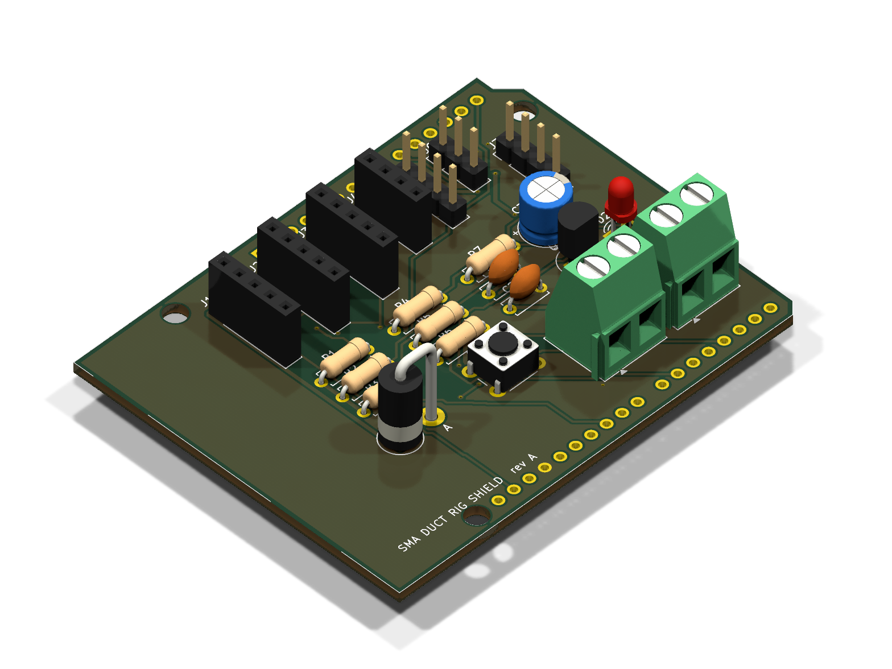

**The firmware** (Arduino Uno: 57 % flash, 55 % RAM):
* **Telemetry:** 20 Hz output in the logger's format.
* **Commands:** heat, fan, PI temperature hold and ramp, and replay of the
  car lap.
* **Safety:** cut-outs for spring over-temperature, reflector
  over-temperature and a broken thermocouple.

**The digital twin:** the same firmware logic is compiled as a PC library
and driven by a physics model of the rig:
* lamp, reflector, wire heat balance, SMA kinetics and the MAPDL stroke
  curve;
* emulated sensors with realistic update rate, lag, resolution and noise.

The unchanged logger connected to it and logged 2,400 samples at 20.0 Hz.

| Virtual test | Result |
|---|---|
| Slow ramp, 2 °C/min | Opens 72-75 °C, closes 63-60 °C, hysteresis 11.5 °C (design 12 °C) |
| Step response | 0.5 mm wire opens in 3.6 s, closes in 1.9 s; 1.2 mm wire closes in 5.7 s |
| Car lap replayed on the rig | Same 3 openings per lap as the car model; open/closed state agrees 87 % of the lap |
| 1,000 heat/cool cycles | Every cycle fully open and closed, no firmware faults |
| Faults | Broken thermocouple or failed blower: lamp latched off |

**Design problems caught before building:**
1. **Heater window too slow.** A 1 s lamp on/off window made the thin wire
   ripple several degrees, and the measured hysteresis shrank to 4.6 °C. It
   is now 200 ms.
2. **First rig too weak.** It could not reproduce the car's peak radiation or
   airflow. The lamp moved closer, the blower was added, and the 12 V diode
   was upgraded from 1 A to 3 A.
3. **Quick tests misread hysteresis.** A quick 60 s heat / 60 s cool test
   reads 3.1 °C, because the thermocouple lags. Transformation temperatures
   must come from the slow ramp test.
4. **Ratcheting hysteresis model.** The textbook partial-loop rule drifted
   under small temperature ripple. It was replaced with a return-point-memory
   model. Re-running the lap model with it gave identical results.

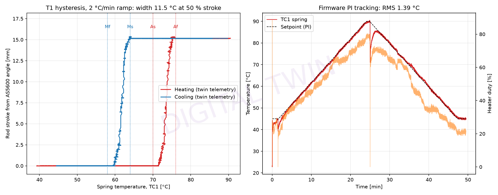

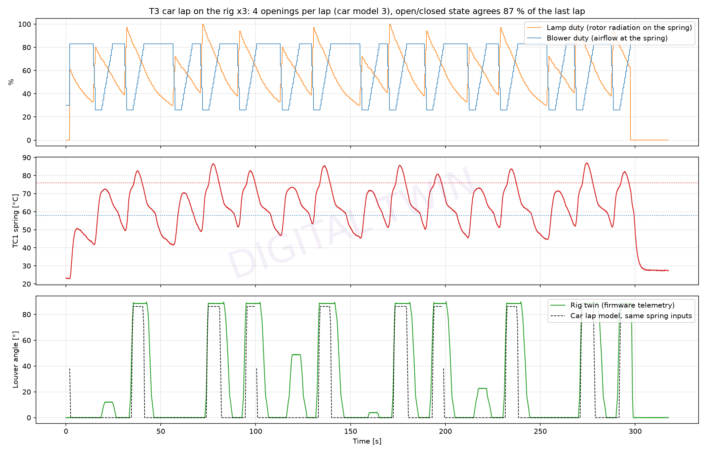

### 5.8 The drag question (Fluent, isolated wheel)

**First attempt:** a duct-sized box gave -2.0 %. It was rejected because the
rotor blocked about 55 % of the box, so the box behaved like a narrow wind
tunnel.

**Second attempt:** a 2.0 x 1.36 x 3.7 m domain around a 720 mm wheel with
cover, rotor and the duct with a forward-facing scoop. 300 km/h, k-ω SST.

**Mesh-independence study:** the case was solved on three meshes, with all
mesh sizes scaled together and the same boundary-layer cells. The Student
licence's 1 million cell limit rules out a finer level.

| Mesh | Cells | Drag open | Drag closed | Change on closing | Solver noise | Momentum limit |
|---|---|---|---|---|---|---|
| Coarse | 284k | 1,247 N | 1,128 N | -9.6 % | ±7.4 % | 1.1 % |
| Medium | 408k | 1,130 N | 1,189 N | +5.2 % | ±5.4 % | 1.4 % |
| Fine | 768k | 1,183 N | 1,168 N | -1.3 % | ±1.2 % | 1.1 % |

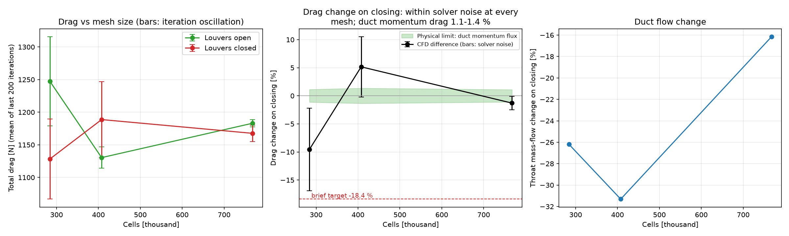

**What the study shows:**
* **The direct CFD difference is not resolved.** It changes sign between
  meshes and stays within the solver's iteration noise every time.
  * The duct's own drag changes by only 1-2 N between open and closed.
  * The total swings come from the wheel's unsteady wake, which a steady
    simulation cannot settle.
* **The scale of the effect.** The duct's own through-flow (momentum) drag
  is the momentum of the air it swallows:
  `D_duct ≈ ṁ V = 0.155-0.183 kg/s x 83 m/s ≈ 13-15 N`
  That is **1.1-1.4 % of the total drag on all three meshes**. It is not a
  hard cap on the change: closing an inlet also changes how the outside flow
  meets the body (interference), and that part can add to or cancel the
  momentum term. The EV shutter study in this project measured interference
  at about four times the momentum term. The brief's -18.4 % would need
  interference more than ten times the momentum term, which is why the
  transient run below was needed to settle it.
* **Resolving the actual difference** needs time-averaged transient CFD with
  a rotating wheel on a moving ground (next step).

**Third step: rotating wheel, moving road, time-averaged.** The wheel, cover
and disc spin at 231.5 rad/s (300 km/h on a 0.36 m tyre) and the ground
moves at 300 km/h, as a real road does under the car. After a steady start,
the flow is solved in 1 ms time steps and the drag is averaged over the
settled 160 ms (fine mesh).

| | Louvers open | Louvers closed |
|---|---|---|
| Steady drag | 1,071.8 N | 1,076.0 N |
| Time-averaged drag (± standard error) | 1,073.5 ± 0.2 N | 1,079.2 ± 0.5 N |
| Change on closing | | **+0.53 % (95 % interval +0.43 to +0.63 %)** |

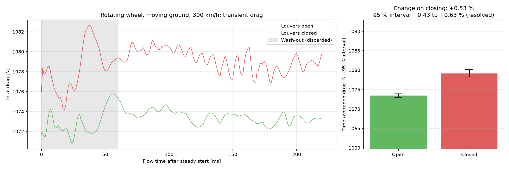

* **Closing the louvers does not save drag in this model; it adds about
  0.5 %.**
  * The duct's own drag falls by only 0.4 N, while the wheel's drag rises by
    more.
  * The two drag traces stay apart for the whole averaging window, and the
    steady runs agree on the direction (+0.4 %).
* **Caveats:** the interval covers sampling noise only. 160 ms is about four
  wake cycles on one mesh, and the drag coefficient (1.19) is still above
  real-wheel values.

**Conclusion of the drag study:** in every model the effect of closing the
louvers is a fraction of a percent, the same order as the duct's 1.1-1.4 %
momentum drag. In the most realistic model it is a small penalty, not a
saving. The brief's
-18.4 % is ruled out.

### 5.9 Phase 7 - Product package

**Module CAD:** 21 components, zero interferences.
* real helical NiTiCu springs with a black coating, and a steel bias spring;
* a rod crosshead, anodised brackets, and an inlet flange with M3 screws;
* materials assigned to every part.

**Supporting assets:**
* **Animation:** the springs genuinely stretch and contract as the louvers
  open and close.
* **Drawing SMA-DM-001:** A3, with a parts list.
* **Product sheet:** one page.

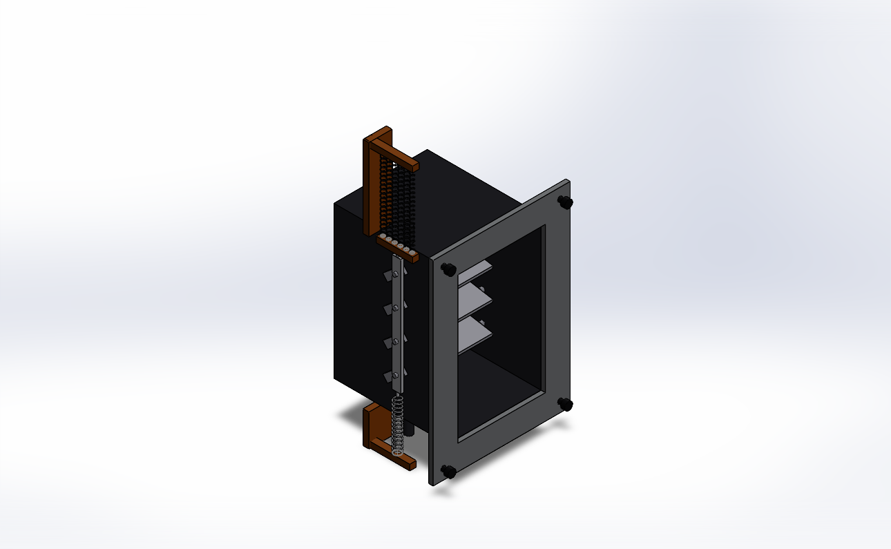

### 5.10 Re-target - passive SMA grille shutter for an electric car

F1 bans moving aero parts, and the brake duct moves too little air to
matter. An EV radiator moves about ten times more air relative to the
car's drag, and its coolant runs at 25-40 °C. That suits a
low-temperature NiTi spring (As 35 / Af 40 °C) sitting in the coolant
return line. Full details are in [EV_COOLING.md](EV_COOLING.md).

**CFD (half car, porous radiator, moving road):**
* Closing the shutters cuts drag by 105 N at 100 km/h and 182 N at
  130 km/h, 14.5 % both times (ΔCd 0.10).
* Iteration noise is under ±10 N.
* The saving scales with V².
* The saving is about four times the radiator's momentum drag (ṁ V). The
  rest is interference from the plain floor exit, which a production car
  would be shaped to avoid.

**Drive-cycle model** (CFD flow coefficient, cooling drag in the road
load):

| Scenario | SMA shutter | Battery energy saved, production-car estimate (κ = 1) |
|---|---|---|
| City 25 °C | stays shut | 3.4 % |
| Motorway 130 km/h, 30 °C | stays shut, coolant 37 °C | 5.4 % (motorised thermostat: 4.5 %) |
| Hot day 38 °C | opens fully | 0 %, same coolant peak as an open grille |

**Module CAD:** six louvers on a glass-filled PA66 frame driven through a
scotch-yoke bar (14.8 mm lift for 80°).
* Five NiTi springs in a clear coolant sleeve lift the bar.
* A steel bias spring pulls it shut.
* Zero interferences shut and fully open.

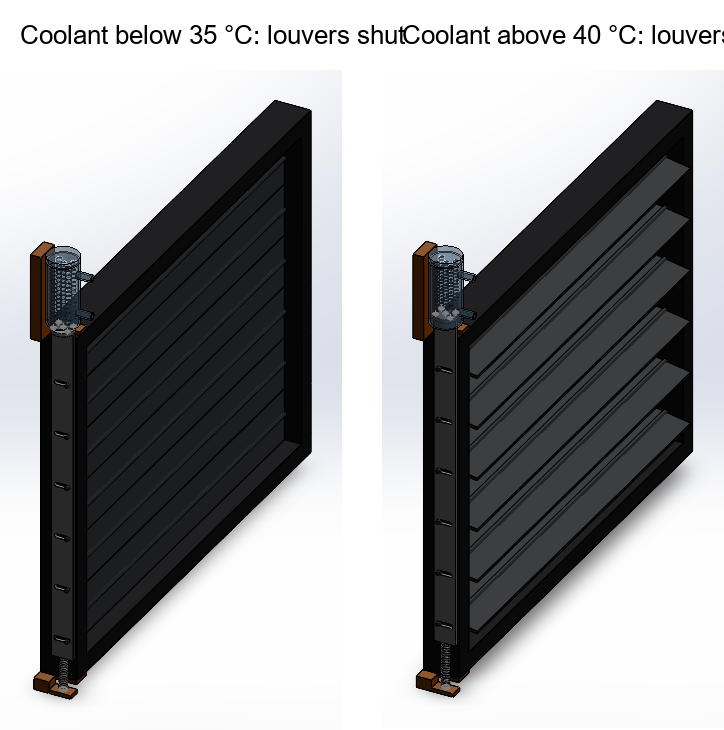

## 6. Key equations

**Wire heat balance** (per unit surface, used for the steady check, the lap
model and the twin):

`ρ c_eff (D/4) dT/dt = ε G / 4 - ε σ (T⁴ - T_amb⁴) - h (T - T_air)`

* G = incident radiation
* ε = wire emissivity
* h = convection coefficient (Churchill-Bernstein)
* c_eff = specific heat including the latent heat of transformation

**Liang-Rogers kinetics** (martensite fraction ξ):

* Heating, As < T < Af: `ξ = (ξ0 / 2) [cos(π (T - As) / (Af - As)) + 1]`
* Cooling, Mf < T < Ms: `ξ = ((1 - ξ0) / 2) cos(π (T - Mf) / (Ms - Mf)) + (1 + ξ0) / 2`

**Crank kinematics:** `stroke = R (sin(θ + φ0) - sin φ0)`

**Duct momentum drag:** `D_duct ≈ ṁ V`. This is the through-flow part
only. Interference with the outside flow adds to it or cancels it, so the
total cooling drag is written `κ ṁ V`, with κ found by CFD.

## 7. Limits

* **Not built:** no physical hardware exists yet. Rig and twin results are
  predictions.
* **Student licence:** meshes are capped at 1 million cells, so the CFD is
  coarse.
  * Thermal-case continuity stalled near 1e-2.
  * The rotating-wheel drag result is averaged over only 160 ms on one mesh.
* **Lap model:** reduced-order, on a synthetic lap; the NiTiCu
  transformation temperatures are design targets, not a datasheet alloy.
* **Rig assumptions:** the twin's lamp irradiance, blower curve and
  heat-transfer coefficients must be calibrated on a real rig.
* **Regulations:** F1 rules ban movable aerodynamic parts, so this is a
  research and non-FIA concept.

## 8. Next steps

1. Order the shield PCB and rig parts, and source NiTiCu springs to the
   76 / 58 °C specification.
2. Build the rig, calibrate it, and repeat the five virtual tests on real
   hardware.
3. Compare measured hysteresis, response time and force with the
   predictions, and update the models.
4. Re-target the concept where it is legal and useful (started: the EV
   grille shutter in section 5.10). Next for it: a production-shaped
   cooling exit in the CFD, a coolant-sleeve bench test, and sourcing a
   35 / 40 °C NiTi grade.

## 9. Repository map

| Folder | Contents |
|---|---|
| `phase1_*.py`, `swlib.py` | Duct, louvers, rod and assembly in SOLIDWORKS |
| `phase2_*.py` | CFD domains, meshing, solves, radiation, wire balance, lap model, wheel aero |
| `phase3_fea.py` | MAPDL mechanism and stress model |
| `phase4_bench_validation.py` | Data logger and correlation |
| `phase5_generate_whitepaper.py` | Whitepaper PDF |
| `rig_cad.py`, `electronics/`, `firmware/` | Bench rig CAD, shield PCB, firmware, digital twin |
| `product_*.py` | Product CAD, animation, drawing, product sheet |
| `ev/` | EV grille-shutter re-target: sizing, half-car CFD, drive-cycle model, shutter CAD |
| `cad/`, `cfd/`, `fea/`, `bench/`, `report/` | Models, plots, result files, PDFs |
| `docs/` | This guidebook, detailed results, rig and product notes |

## 10. Glossary

| Term | Meaning |
|---|---|
| Af / As | Austenite finish / start: temperatures at which the spring finishes / starts recovering its shape |
| Mf / Ms | Martensite finish / start: temperatures at which it finishes / starts becoming soft again |
| Hysteresis | Gap between opening and closing temperatures |
| Bias spring | Steel spring that re-stretches the cold SMA spring |
| CHT | Conjugate heat transfer: heat in solids and fluid solved together |
| DO radiation | Discrete Ordinates: Fluent's radiation model |
| k-ω SST | Turbulence model suited to separated flow near walls |
| FoS | Factor of safety: material strength divided by working stress |
| Digital twin | Software copy of the rig that runs the real firmware against a physics model |
| ERC / DRC | Electrical / design rule check in KiCad |
| Gerbers | Manufacturing files a PCB fab uses to make the board |
| Emissivity | How well a surface absorbs and emits thermal radiation (0 to 1) |
