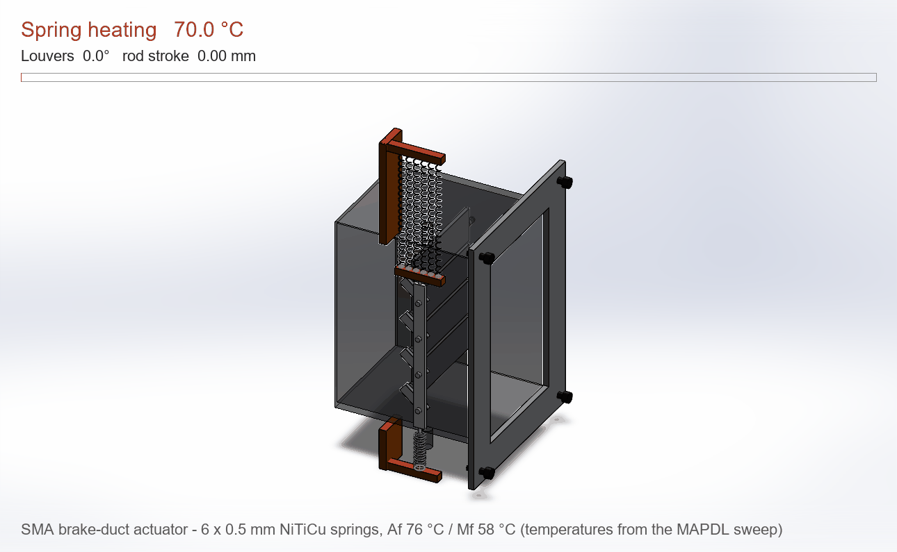

# SMA brake-duct actuator module: product design package

A passive, temperature-driven louver actuator for brake cooling. When the
brakes get hot, six black-coated NiTiCu springs contract and swing four
louvers open through a crank linkage. When the brakes cool, a steel bias
spring closes them again. There are no electronics, wires or power supply.

*The springs genuinely stretch and contract in this animation. Each frame
re-pitches the coil springs in SOLIDWORKS and re-poses the louvers, rod and
crosshead with the crank kinematics. Temperatures are from the MAPDL
six-spring sweep.*

## Package contents

| Item | File |
|---|---|
| Product sheet (1 page) | `report/SMA_Duct_Module_Product_Sheet.pdf` |
| Assembly drawing SMA-DM-001 (A3, 3 views + isometric + parts list) | `cad/product/SMA-DM-001.pdf` / `.SLDDRW` |
| Module CAD (SOLIDWORKS, 10 part types, 21 components, 0 interferences) | `cad/product/SMA_Duct_Module.SLDASM`, `.STEP` |
| Actuation animation | `cad/product/SMA_Duct_Module_actuation.gif` |
| Bench rig with the real shield PCB in 3D (0 interferences) | `cad/rig/Bench_Rig.SLDASM`, `.STEP` |
| Shield PCB 3D model (KiCad export, all components) | `electronics/kicad/sma_rig_shield.step` |
| Gerbers, BOM, firmware, digital twin | see `docs/RIG.md` |

## Specification

| | |
|---|---|
| Actuator | 6 x NiTiCu springs: 0.5 mm wire, 2.5 mm coil, 19 turns, high-emissivity black coating; steel bias spring 0.8 mm wire, 5 mm coil |
| Trigger | Opens 72-75 °C, closes 63-60 °C, hysteresis 11.5 °C (digital-twin slow ramp; alloy design Af 76 / Mf 58 °C) |
| Output | 15.15 mm rod stroke, louvers 0 to 88.5°, 33.9 N pack force (MAPDL) |
| Response | Opens in 3.6 s, closes in 1.9 s (digital twin, 0.5 mm wire) |
| Structure | All stress checks pass, lowest factor of safety 3.3 (MAPDL) |
| Envelope | 89 x 182 x 94 mm: CFRP throat, 4 titanium louvers, steel linkage, anodised brackets, Al inlet flange with 4 x M3 |

## Parts list (from the drawing)

| No. | Part | Qty |
|---|---|---|
| 1 | Brake_Duct_Housing (CFRP) | 1 |
| 2 | Nitinol_Louver_Flap (Ti) | 4 |
| 3 | Control_Linkage_Rod (steel) | 1 |
| 4 | Rod_Crosshead (anodised Al) | 1 |
| 5 | Spring_Bracket_Top (anodised Al) | 1 |
| 6 | Spring_Bracket_Bottom (anodised Al) | 1 |
| 7 | Inlet_Flange (Al) | 1 |
| 8 | SMA_Spring_NiTiCu_0p5 | 6 |
| 9 | Bias_Spring_Steel | 1 |
| 10 | Screw_M3x10 socket head | 4 |

## Status

This is a fabrication-ready prototype design, verified by simulation (Fluent,
MAPDL) and by a digital twin of its test rig. **No physical unit has been
built yet.** The NiTiCu springs with the Af 76 °C / Mf 58 °C window must be
specified to a supplier. The drawings carry the SOLIDWORKS Educational
watermark because they were made with the student licence.

Scripts: `product_cad.py` (parts and assembly), `product_animate.py` (GIF),
`product_drawing.py` (drawing), `product_sheet.py` (PDF sheet),
`rig_import_pcb.py` (PCB into SOLIDWORKS).
