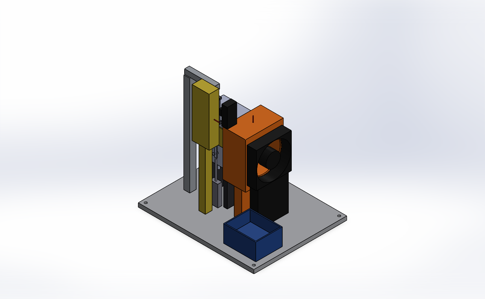
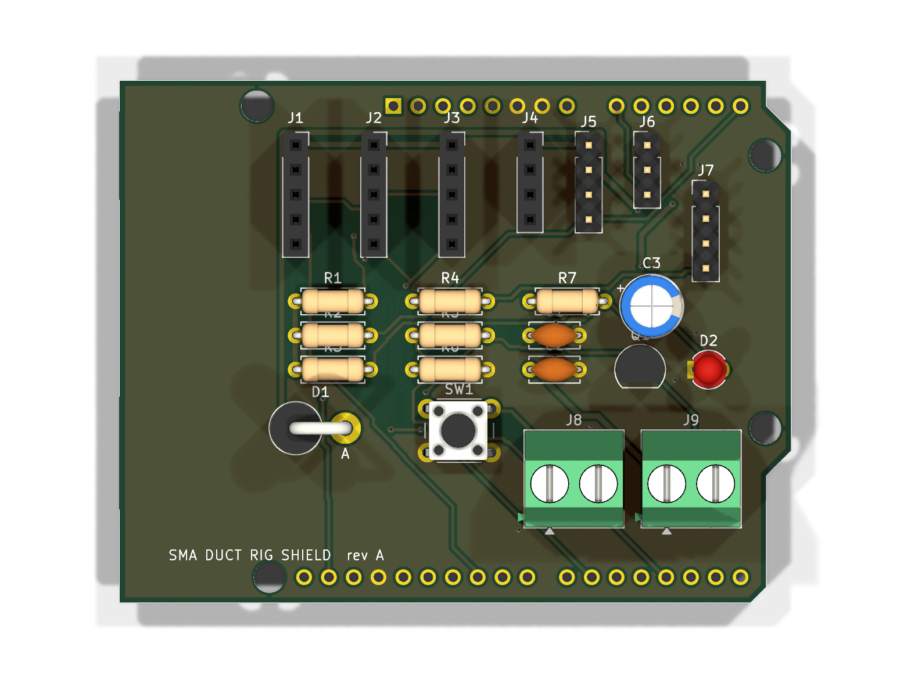
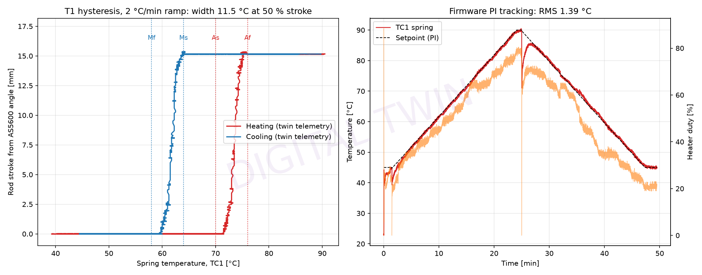
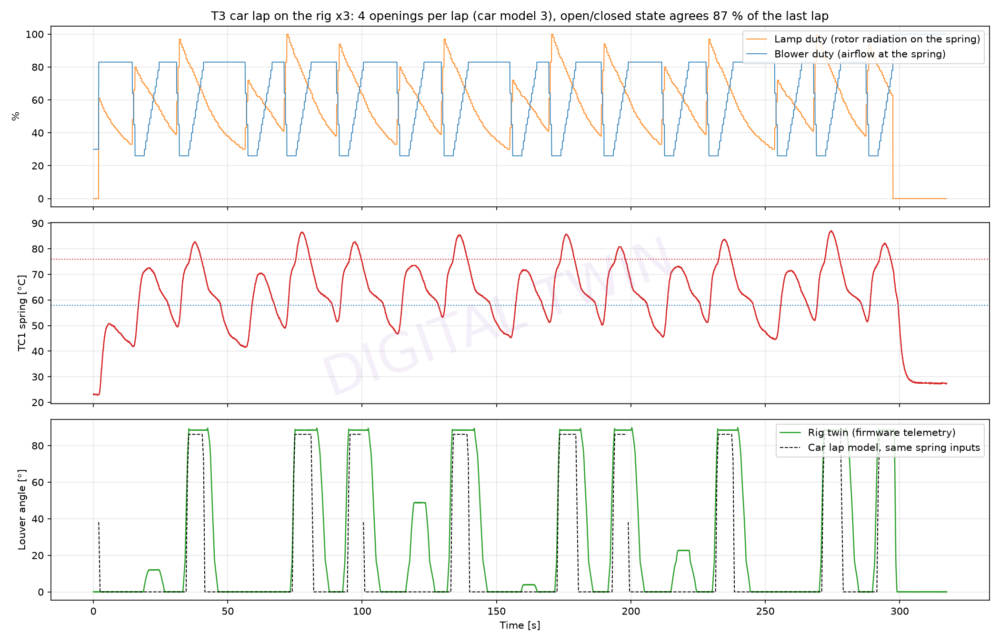

# Bench rig: design, electronics, firmware and virtual testing

The next step after the simulations is a bench rig that heats the SMA spring
pack like a braking rotor and cools it like car airflow, and measures what the
louvers actually do. Everything below was designed and tested on a laptop. No
hardware has been built yet, so every result in this file is a **digital-twin
prediction**, not a measurement.



## What the rig does

| Function | How |
|---|---|
| Rotor radiation | 500 W R7s halogen lamp in a U reflector, axis 23 mm from the springs (about 143 kW/m² at 100 %; the car peaks at 129 kW/m²) |
| Car-speed cooling | 50 mm PWM blower with a nozzle on the spring pack (about 13 m/s at 100 %; the car gives 5.3-11.2 m/s) |
| Duct flow | 92 mm PWM fan through a printed plenum into the duct throat, pitot on the plenum |
| Spring temperature | 0.25 mm K-type bead on the springs (TC1), plus plenum air (TC2) and reflector (TC3) |
| Louver angle and stroke | AS5600 magnetic encoder on louver 2's free shaft; stroke from the crank kinematics |
| Actuation force | 5 kg bar load cell between the spring pack and the frame |
| Safety | firmware cut-outs (spring 110 °C, reflector 350 °C, open thermocouple) plus a KSD301 120 °C thermal fuse in the lamp circuit |

All parts are in `cad/rig/` (SOLIDWORKS, built by `rig_cad.py`). The
assembly passes SOLIDWORKS interference detection with zero clashes. The
indicative bill of materials is in `bench/rig_bom.csv`.

## Electronics

An Arduino Uno shield, designed in KiCad 10 (`electronics/`):

* Schematic generated from one design table (`shield_design.py`). ERC passes
  with 0 violations.
* 2-layer, 68.6 x 53.3 mm board, all through-hole for hand soldering.
  Routed by `make_pcb.py`, with ground pours on both layers.
  KiCad DRC: 0 errors, 0 unconnected nets, 0 schematic mismatches.
* Manufacturing files: `electronics/kicad/sma_rig_shield_gerbers.zip`
  (Gerbers + drill), BOM and placement files in `electronics/kicad/fab/`.



## Firmware

`firmware/sma_rig/` compiles for the Uno with arduino-cli: 57 % flash,
55 % RAM. The logic lives in `rig_core.cpp`, which has no Arduino
dependencies. The sketch only reads the sensors and drives the outputs.

* Telemetry: one JSON line every 50 ms (20 Hz), in the format the Phase 4
  logger already reads.
* Commands: `HEAT`, `FAN`, `HOLD` (PI temperature control), `RAMP`,
  `LAP` (the car lap), `COOL`, `STOP`, `TARE`, `CAL`, `ZERO`, `LIMIT`,
  `RESET`, `STATUS`.
* The lap profile (`lap_profile.h`) is generated from the transient lap model
  by `gen_lap_profile.py`. It matches the spring's heat balance, not just the
  raw numbers. The blower curve is inverted, and the lamp adds the convective
  heat the warmer car air would supply.

## Digital twin

`firmware/twin/rig_twin.py` runs the **same `rig_core.cpp`**, compiled as a
Windows DLL with MSVC. It drives the code with a physics model of the rig:

* lamp and reflector heating;
* the spring-wire heat balance from the lap model;
* SMA kinetics, using a return-point-memory hysteresis model;
* stroke from the MAPDL six-spring sweep;
* emulated sensors with realistic update rates, lag, resolution and noise.

It can also serve a TCP "serial port", so the unchanged Phase 4 logger
connects to it as if it were the real board:

```bash
python firmware/twin/rig_twin.py serve --port 7777
```

```bash
python phase4_bench_validation.py --port socket://localhost:7777 --source-label "DIGITAL TWIN" --heat-cmd "HOLD 90" --cool-cmd COOL --as-c 70 --af-c 76 --ms-c 64 --mf-c 58 --stroke-max 15.15 --force-max 15.2
```

That run logged 2,400 samples at 20.0 Hz with no stale data
(`bench/virtual/Logger_Twin_*`).

## Virtual test campaign (`firmware/twin/rig_campaign.py`)

| Test | Result (twin) |
|---|---|
| T1 hysteresis, 2 °C/min ramp | Opens at 72.0-75.0 °C, closes at 63.3-60.0 °C. Width 11.5 °C at 50 % stroke (alloy design: 12 °C). Full stroke 15.35 mm, 90.1°, 15.4 N above preload. Thermocouple tracks the wire to 0.24 °C RMS. |
| T2 step response | 0.5 mm wire opens (90 %) in 3.6 s and closes in 1.9 s. 1.2 mm wire: 6.1 s and 5.7 s. Closing is 3x faster with the thin wire. |
| T3 car lap on the rig | The same 3 big openings per lap as the car lap model, at the same moments. The open/closed state agrees 87 % of the lap. The rig runs 2-4 °C warm, so it closes about 4 s later and adds one partial opening. |
| T4 endurance | 1,000 cycles (6.9 h of rig time): every cycle fully open and fully closed, 0 faults, telemetry gaps 41-59 ms throughout. The twin has no fatigue model, so this checks the firmware and procedure only. |
| T5 faults | Open thermocouple: heater latched off within 10 ms; `HEAT` refused until `RESET`. Blower failure with the lamp at 100 %: cut-out at 111.5 °C, then the spring overshoots to 119.5 °C before cooling. |




## Design problems the twin caught before building

1. **Heater window too long.** With a 1 s time-proportioning window, the
   0.5 mm wire (heating at about 30 °C/s under the lamp) rippled several
   degrees within each window. Transformation then started early and the
   measured hysteresis shrank from 12 °C to 4.6 °C. The window is now 200 ms.
2. **Rig too weak for the car lap.** The first layout gave 110 kW/m² and
   5 m/s, against a car lap needing up to 129 kW/m² and 11 m/s. The lamp moved
   7 mm closer, a dedicated blower was added, and the 12 V diode was upgraded
   from 1N5819 (1 A) to 1N5822 (3 A).
3. **Quick-cycle logging distorts hysteresis.** The logger's 60 s heat / 60 s
   cool test reports a 3.1 °C hysteresis, because the thermocouple bead lags
   the wire. Measure transformation temperatures with the slow `RAMP` test and
   use quick cycles only for stroke, force and timing.
4. **Hysteresis model ratcheting.** The plain Liang-Rogers reversal rule
   restarted the transformation at every small temperature ripple. The twin
   uses return-point memory instead. Re-running the transient lap model with
   the fix gave identical results, because the car inputs are smooth.
5. **Phase 1 CAD bug.** The linkage rod had solved on the wrong side of the
   duct, 70 mm from the crank pins: concentric mates only align axes. The
   assembly script now checks and flips the distance mate. Rod stroke is
   unchanged at 14.000 mm for 80°.

## Calibrate before trusting a real run

* Lamp irradiance at the spring line at 100 % (heat-flux gauge). The twin
  assumes 143.5 kW/m².
* Blower air speed at the spring vs duty (anemometer). The twin assumes
  rpm = 600 + 2400 d and 13 m/s at 3000 rpm.
* Load cell span (`CAL <grams>` with a known mass), angle zero (`ZERO`
  with the louvers closed), room temperature.
* Then trim the lamp duty so the rig's T1 transformation temperatures match
  the alloy datasheet before running the lap profile.
